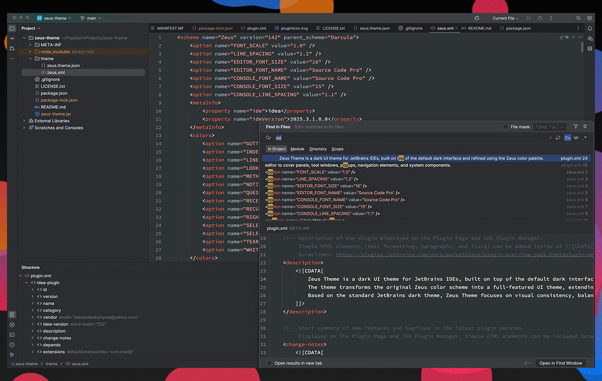

# JetBrains Zeus Theme

[Zeus](https://github.com/alexanderkulnyow/zeus-theme) theme for JetBrains.

## Setup

After installing the theme, go to `Preferences | Appearance & Behavior | Appearance` and select **Zeus** in the theme dropdown. Click **OK** to apply the changes.

## License

This color scheme is based on [Zeus-Theme](https://github.com/zaynali53/Zeus-Theme) by [Zayn Ali](https://github.com/zaynali53), licensed under the MIT License. 

Modified by Alexander Kulnyow.

MIT License. See [LICENSE.txt](LICENSE.txt) for details.
